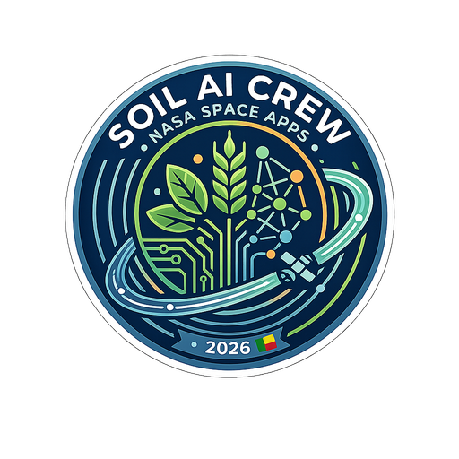
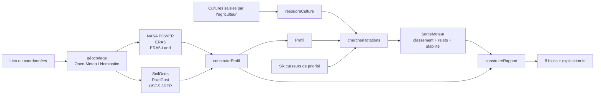

🇬🇧 English version: [README.md](./README.md)



# Sillon

Sillon transforme un point géographique en une décision de rotation culturale classée et
auditable pour un agriculteur d'Afrique de l'Ouest, à partir de données d'observation de la Terre
et de sol interrogées en direct — sans jeu de données de démonstration, sans catalogue de
rotations codé en dur.

---

## 1. Ce que c'est

Vous donnez un lieu (un nom, des coordonnées, ou votre position) et les cultures que vous pratiquez
réellement. Sillon interroge des services publics d'observation de la Terre et de sol, en déduit les
propriétés agronomiques de ce point, construit toutes les successions de deux et trois cultures à
partir de vos cultures, retire les infaisables avec une raison écrite, classe le reste selon les
priorités que vous avez déclarées, et rédige un rapport en huit blocs en français simple — avec
l'argent en FCFA par hectare, toujours comparé à votre rotation actuelle.

Réalisé pour le NASA Space Apps Challenge 2026, challenge *Field Shift: Adapting Farms with NASA
Data*. Public de ce document : les jurys qui doivent auditer les algorithmes, vérifier un chiffre et
lancer l'application en local.

## 2. Comment l'application répond au challenge

Le brief nomme cinq piliers. Ce tableau associe chaque pilier au fichier et à la fonction qui le
traite. La première colonne condense le brief tel qu'il a été transmis à l'équipe ; ce n'est pas une
citation mot pour mot de la page officielle.

| Exigence du challenge | Où elle est traitée |
| --- | --- |
| Observations de la Terre : pluie, température, demande évaporative, humidité du sol, imagerie satellite | `src/api/sources.ts` — `chargerPower` (ligne 100), `chargerEra5` (183), `chargerHumiditeSol` (231), `tuilesGibs` (612) |
| Données de sol : texture, carbone organique, pH, eau disponible pour la plante | `src/api/sources.ts` — `solIsric` (293), `chargerClassificationSol` (514) ; agrégation dans `src/analyse/features.ts` — `construireProfil` (260) |
| Caractéristiques des cultures : demande en eau saisonnière, enracinement, fixation d'azote, restes de récolte, délai de retour | `src/data/cultures.ts` — `Culture` (15), `CULTURES` (63), 23 cultures |
| Priorités de l'exploitant : revenu, sécurité alimentaire, économie d'eau, autonomie en intrants, sol, main-d'œuvre | `src/App.tsx` — `CURSEURS` (49) ; `src/moteur/moteur.ts` — `calculerPoids` (76) |
| Stratégies de rotation | `src/moteur/moteur.ts` — `construireEspace` (250), `chercherRotations` (680) |
| Rendre le résultat utilisable et contestable par l'agriculteur | `src/rapport/rapport.ts` (8 blocs), `src/rapport/explication.ts` (couche en trois temps) |

## 3. Lancer en cinq étapes

```bash
git clone https://github.com/gandxo-tech/sillon.git
cd sillon
npm install
npm run dev          # http://localhost:3000  (vite.config.ts, ligne 13)
```

Build de production et vérifications :

```bash
npm run build        # tsc --noEmit && vite build
npm test             # suites du moteur et de l'explication
```

Variables d'environnement, toutes deux facultatives :

| Variable | Côté | Effet si absente |
| --- | --- | --- |
| `VITE_GOOGLE_MAPS_API_KEY` | navigateur (`src/components/PointMap.tsx`, ligne 12) | vue satellite intégrée, sans déplacement du point au clic |
| `GROK_KEY` (alias : `GROQ_API_KEY`) | serveur (`api/ia.js`) | `/api/ia` répond 503 avec un message explicite ; le reste de l'application fonctionne |

Aucune clé n'est nécessaire pour obtenir un rapport complet.

## 4. Architecture

```
api/
  ia.js                     fonction Vercel : POST uniquement, contexte borné vers Groq
src/
  App.tsx                   machine à états de l'interface : lieu → cultures → priorités → rapport
  api/
    http.ts                 fetchJson avec délai maximal, erreurs lisibles, petites statistiques
    sources.ts              une fonction par service public ; tous les endpoints sont ici
  analyse/
    features.ts             réponses brutes → Profil (climat, sol, relief, état des sources)
    rotations.ts            bilan hydrique, RUSLE, azote, matière organique, notation
  data/
    cultures.ts             23 cultures : kc, part de saison, enracinement, azote, restes
  moteur/
    des.ts                  hash FNV-1a, générateur mulberry32, index de variante déterministe
    moteur.ts               espace de recherche, filtres durs, notation pondérée, stabilité
    __tests__/              six cas moteur + jeux d'essai (scenarios.ts)
  rapport/
    rapport.ts              8 blocs, FCFA/ha, mois, tableau de comparaison
    explication.ts          6 archétypes de zone, explications en trois temps, 6 variantes
    variantes.ts            6 formulations par emplacement, déterministes, jamais réutilisées
    leviers.ts              une action concrète par code de rejet, classée par cas débloqués
    technique.ts            bloc 8 replié (seul endroit où le jargon est autorisé)
    __tests__/              11 cas d'explication + tableau de contrôle
  components/               carte, graphiques, badge de verdict, choix des cultures, lecture audio
```

Flux de données :



## 5. Sources de données

| Source | Endpoint | Variables demandées | Résolution | Licence / attribution | Repli en cas d'échec |
| --- | --- | --- | --- | --- | --- |
| NASA POWER (LaRC) | `power.larc.nasa.gov/api/temporal/daily/point` (community `AG`) | `PRECTOTCORR`, `T2M`, `T2M_MAX`, `T2M_MIN`, `GWETTOP` | 0,5° × 0,625°, quotidien, 10 ans | libre et ouvert, citer NASA POWER | aucun : le rapport s'arrête avec une erreur explicite |
| ERA5 (Copernicus/ECMWF, via Open-Meteo Archive) | `archive-api.open-meteo.com/v1/archive` | `precipitation_sum`, `temperature_2m_mean/min/max`, `et0_fao_evapotranspiration` | grille native ERA5 0,25° (≈ 25–30 km) ; l'étiquette dans l'app affiche désormais la grille native (le fournisseur annonce aussi ≈ 9 km — voir limites) | licence Copernicus, attribution « Generated using Copernicus Climate Change Service information » | demande de référence FAO-56 recalculée par Hargreaves sur les températures POWER (`features.ts`, `et0Hargreaves`, ligne 82) |
| ERA5-Land (via Open-Meteo Archive) | même endpoint, `hourly=soil_moisture_0_to_7cm` | humidité du sol 0–7 cm, moyennes mensuelles | ≈9 km | licence Copernicus | `humiditeSol: null` ; les courbes disparaissent du graphique |
| SoilGrids 2.0 (ISRIC) | `rest.isric.org/soilgrids/v2.0/properties/query` | `clay`, `sand`, `silt`, `soc`, `phh2o`, `wv0033`, `wv1500` à 0-5, 5-15, 15-30, 30-60 cm | 250 m | CC BY 4.0, citer ISRIC | ré-encodage PixelGust de SoilGrids (`solPixelGust`, ligne 333), puis valeurs par classe WRB (`chargerClassificationSol`, ligne 514), puis valeurs par défaut documentées |
| Classification SoilGrids | `rest.isric.org/soilgrids/v2.0/classification/query` | classe WRB | 250 m | CC BY 4.0 | table de valeurs par classe, source marquée `wrb` ou `defaut` |
| USGS 3DEP (EPQS) | `epqs.nationalmap.gov/v1/json` | altitude en 5 points espacés de 1 km | 1 m, États-Unis seulement | domaine public (gouvernement américain) | altitude Open-Meteo (Copernicus DEM GLO-90) `api.open-meteo.com/v1/elevation` |
| Prévisions Open-Meteo | `api.open-meteo.com/v1/forecast` | pluie, tmin, tmax, ET0 sur 14 jours | 1–11 km | données CC BY 4.0, gratuit en usage non commercial | section masquée |
| CMIP6 (Open-Meteo Climate API) | `climate-api.open-meteo.com/v1/climate` | pluie et température quotidiennes, un modèle | ~25 km | CC BY 4.0 | carte de projection masquée |
| NASA GIBS | `gibs.earthdata.nasa.gov/wmts/epsg3857/best/MODIS_Terra_CorrectedReflectance_TrueColor/...` | tuiles en couleurs vraies | 250 m, quotidien | imagerie NASA, citer NASA EOSDIS GIBS | fond de carte satellite intégré conservé |
| Géocodage Open-Meteo | `geocoding-api.open-meteo.com/v1/search` | noms de lieux | — | CC BY 4.0 | saisie manuelle des coordonnées |
| OpenStreetMap / Nominatim | `nominatim.openstreetmap.org/reverse` | géocodage inverse | — | ODbL, attribution « © OpenStreetMap contributors » | lieu nommé par ses coordonnées |
| Google Maps JavaScript API | `maps.googleapis.com/maps/api/js` | fond satellite, déplacement du point au clic | imagerie 1 m | conditions Google Maps Platform ; clé restreinte par référent HTTP | carte intégrée sans interaction |

L'état de chaque source est enregistré dans `Profil.sources` et imprimé dans le bloc 8 : un service
en échec est visible, jamais remplacé en silence.

```ts
// src/api/sources.ts, lignes 69 et 104-110
const PARAMS_POWER = ['PRECTOTCORR', 'T2M', 'T2M_MAX', 'T2M_MIN', 'GWETTOP'];
const url =
  `https://power.larc.nasa.gov/api/temporal/daily/point?parameters=${PARAMS_POWER.join(',')}` +
  `&community=AG&longitude=${lon.toFixed(4)}&latitude=${lat.toFixed(4)}` +
  `&start=${debutAnnee}0101&end=${finAnnee}1231&format=JSON`;
```

## 6. Algorithmes

Toutes les formules sont dans `src/analyse/rotations.ts` (`calculerScenario`, ligne 95) et
`src/analyse/features.ts`. Aucune formule n'est réécrite dans le moteur.

**Bilan hydrique.** La demande est la demande de référence de la saison, pondérée par le
coefficient cultural de chaque plante et par la part de saison qu'elle occupe ; l'apport est 85 %
de la pluie de saison, plus l'eau que le sol garde pour ces cultures, plus l'irrigation déclarée.

```
demande = moy(et0Saison × kc × partSaison)             [mm]
reserve = awcMm × moy(facteurReserve)                  [mm]
apport  = 0.85 × pluieSaison + reserve + irrigation    [mm]
deficit = max(0, demande − apport)                     [mm]
stress  = deficit / demande                            [0–1]
perte   = (0.95 − 0.42 × tolerance) × stress^0.85       [fraction du rendement]
rendement = bornes(1 − perte, 0.35, 1)                 [fraction]
```

Le facteur 0,85 représente la part de la pluie qui s'infiltre réellement ; la borne basse 0,35 est
le seuil sous lequel le modèle refuse d'extrapoler. Ce sont deux hypothèses, pas des mesures.

**Érosion (RUSLE).** L'érosivité de la pluie est un ajustement quadratique sur la pluie annuelle,
bornée à 150–2400 mm ; LS suit la forme pente-longueur avec la pente en pourcentage (2 % supposés
quand le relief manque) ; K vient d'une table de texture (`features.ts`, `facteurK`, ligne 227).

```
R  = 587.8 − 1.219 P + 0.004105 P²        [MJ mm ha⁻¹ h⁻¹ an⁻¹], P borné à 150–2400 mm
LS = (100/22.13)^0.4 × (0.065 + 4.56 s + 65.41 s²),  s = pente / 100
A  = max(0.1, R × K × LS × C / 10)       [t ha⁻¹ an⁻¹]
```

**Azote.** `azote = max(0, moy(demande azote) − 0.55 × moy(fixation))` en kg N/ha, valorisé à
650 FCFA/kg (`PRIX_N_FCFA_KG`, `src/data/cultures.ts`, ligne 210).

**Matière organique.** `mo10 = 10 × (0.018 × (residus − 3.2) + 0.03 si couverture > 0.9)`, en points
sur dix ans.

**Sous-scores (0–100).** Eau `bornes(100 × efficience^0.8 × (0.86 + 0.14 × tolerance) − 25 ×
stress)` ; sol `0.55 × (100 − erosion/9×100) + 0.25 × (50 + mo10×200) + 0.2 × (100 − azote×0.45)` ;
revenu `bornes(100 × revenuNetFcfa / 560 000)` ; sécurité alimentaire `0.6 × calories + 0.4 × part
autoconsommée − 25 × rupture` ; intrants `100 × (1 − coût annuel des intrants / revenu net annuel)`
plus une prime légumineuse de 8 à 14 points et une prime d'ordre de 4 points par transition
légumineuse → non-légumineuse ; travail `100 − 100 × jours / 120`.

**Agrégation.** Les poids valent `1 + k × curseur`, k = 3 (revenu, sécurité alimentaire), 2 (eau,
intrants), 1 (sol, main-d'œuvre), normalisés à 1 (`calculerPoids`, `moteur.ts`, ligne 76). Le score
est la somme pondérée des sous-scores, bornée à 0–100.

```ts
// src/analyse/rotations.ts, lignes 108-116
const demandeEau = moy(cultures.map((c) => et0Saison * c.kc * c.partSaison));
const reserveMobilisable = ctx.awcMm * moy(cultures.map((c) => c.facteurReserve));
const apportEau = pluieSaison * 0.85 + reserveMobilisable + ctx.irrigation;
const deficit = Math.max(0, demandeEau - apportEau);
const stress = demandeEau > 0 ? deficit / demandeEau : 0;
const perte = stress > 0 ? (0.95 - 0.42 * tolerance) * Math.pow(stress, 0.85) : 0;
const rendement = bornes(1 - perte, 0.35, 1);
```

**Seuils de rejet.** Un stress supérieur à 0,55 écarte une succession ; une perte de terre
supérieure à 7 t/ha/an sur une pente de plus de 8 % l'écarte ; un coût annuel d'intrants supérieur au
budget déclaré l'écarte (budget : 100 000 / 250 000 / 500 000 FCFA par hectare et par an,
`CAPITAL_FCFA`, ligne 98) ; un pH hors plage, un délai de retour inférieur à 60 % du délai conseillé,
ou une culture fourragère sans cheptel déclaré l'écartent aussi.

## 7. Moteur de décision

Il n'y a pas de catalogue de rotations. `construireEspace` (`moteur.ts`, ligne 250) prend les
cultures saisies par l'agriculteur et génère toutes les paires et tous les triplets ordonnés **à
partir de ces seules cultures** (8 au maximum, dédoublonnés par identifiant), en écartant les
successions dont les cycles ne tiennent pas dans la saison (+15 jours de tolérance). La base de
référence de 23 cultures n'est ouverte que si aucune de ces successions ne survit aux filtres
durs ; le rapport indique alors que la recherche a été élargie. Une culture que l'exploitant ne
possède pas n'est jamais proposée en silence.

Pourquoi le catalogue codé en dur a été supprimé : une bibliothèque de 18 archétypes renvoyait
toujours une de ses propres rotations, si bien qu'un agriculteur qui cultive du dolique ou du taro
recevait une rotation qu'il ne pratique pas. Avec un espace généré, ses cultures sont le vocabulaire,
une culture inconnue reçoit des coefficients génériques signalés comme approximatifs, et la réponse
reste exprimable avec ce qu'il possède.

Enchaînement (`chercherRotations`, ligne 680) :

1. poids issus des six curseurs ;
2. génération de l'espace à partir des cultures saisies ;
3. évaluation de chaque succession (eau, érosion, azote, matière organique, revenu, travail) ;
4. filtres durs, chacun rendant un code et une phrase en français (`verifier`, ligne 472) ;
5. référence = la rotation actuelle de l'agriculteur, évaluée mais jamais filtrée ;
6. classement par score pondéré ; les égalités sont tranchées par identifiant, donc la sortie est stable ;
7. liste des rejets, un représentant par cause, pour qu'une cause fréquente ne masque pas une cause rare ;
8. test de stabilité : tout le classement est recalculé à −10 % et −20 % de pluie ; le résultat est
   `fragile` quand l'écart entre le premier et le troisième tombe sous 4 points.

Codes de rejet : `CYCLE`, `RETOUR`, `PH`, `EROSION`, `MARCHE`, `CAPITAL`, `EAU`.

```ts
// src/moteur/moteur.ts, lignes 514-530
const budget = CAPITAL_FCFA[e.capital];
const coutAnnuel = m.coutIntrantFcfaHa / s.cultures.length;
if (coutAnnuel > budget) {
  return {
    code: 'CAPITAL',
    cause: 'budget',
    phrase: `${s.nom} écartée : ${Math.round(coutAnnuel / 1000) * 1000} FCFA d’intrants par hectare et par an, votre budget est de ${Math.round(budget / 1000) * 1000} FCFA.`,
  };
}
if (m.base.stress > 0.55) {
  return { code: 'EAU', cause: 'eau', phrase: `${s.nom} écartée : elle manquerait d’eau à ${Math.round(m.base.stress * 100)} %, au-delà de 55 % on ne tente pas.` };
}
```

## 8. Couche de langage simple

`src/rapport/explication.ts` transforme un verdict chiffré en trois phrases, toujours dans cet
ordre : le constat sur la parcelle, ce que cela implique pour la rotation, ce que cela coûte à
l'agriculteur. Six archétypes sont calculés depuis les données déjà chargées — rien n'est saisi :

| Archétype | Seuil explicite | Mesuré depuis |
| --- | --- | --- |
| `sec` | pluie annuelle / demande annuelle de référence < 0,50 | pluie POWER, demande ERA5 |
| `pluies_fortes` | ≥ 6 mm par jour de saison | pluie de saison / durée de saison |
| `pente` | ≥ 2 % | USGS 3DEP / Copernicus DEM |
| `terre_lourde` | argile ≥ 35 % sur 0–30 cm | SoilGrids |
| `terre_sableuse` | sable ≥ 70 % sur 0–30 cm | SoilGrids |
| `plaine_basse` | altitude ≤ 350 m et pente < 2 % | MNT |

Règles de rédaction, vérifiées par les tests : 20 mots par phrase au maximum, deuxième personne du
pluriel, voix active, un chiffre par explication et toujours comparé à la rotation actuelle, argent
en FCFA par hectare, dates en mois, pas de « il faut », pas de « optimal », pas de « recommandé par
le modèle ». Un verdict favorable finit toujours par une réserve concrète. Deux archétypes au
maximum sont cités — les deux dont la marge au-dessus du seuil est la plus grande ; un seuil non
franchi ne peut jamais être cité. Quand aucun seuil n'est franchi, l'explication le dit au lieu
d'inventer une cause.

Chaque emplacement dispose de six formulations ; le choix vaut `hash(parcelle, emplacement) % 6`, et
une formulation déjà utilisée dans le même rapport est écartée (`tirer`, ligne 361).

```ts
// src/rapport/explication.ts, lignes 80-88
sec: {
  seuil: 'pluie annuelle divisée par la soif de l’air < 0,50',
  marge: (m) =>
    m.soifAirAnnuelleMm > 0 && m.pluieAnnuelleMm / m.soifAirAnnuelleMm < 0.5
      ? (0.5 - m.pluieAnnuelleMm / m.soifAirAnnuelleMm) / 0.5
      : 0,
},
```

Chaque explication porte `{ texte, archetypes, faits, source }` : les archétypes cités, la valeur
mesurée avec son seuil, et le nom du calcul d'origine. La trace est imprimée dans le bloc 8, replié
par défaut — un jury peut donc remonter de la phrase au chiffre en un clic sans qu'un seul mot
technique n'apparaisse dans les blocs 1 à 7.

## 9. Structure du rapport

Huit blocs, dans cet ordre (`construireRapport`, `src/rapport/rapport.ts`, ligne 120) :

1. **La réponse** — oui / oui sous conditions / non, en une phrase, avec le nom de la rotation.
2. **Pourquoi** — l'explication en langage simple, puis trois raisons au plus, liées aux critères gagnés.
3. **Ce que ça change chez vous** — tableau de comparaison : votre rotation plus les trois options,
   lignes travail, argent (FCFA/ha), eau (mm manquants).
4. **Les trois options, classées** — score sur 100, ce que chacune gagne, ce que chacune coûte.
5. **Si la saison tourne mal** — ce qui change avec 20 % de pluie en moins, quelle option tient, quand semer.
6. **Ce que l'outil ne sait pas** — cinq angles morts permanents (tassement, ravageurs, qualité des
   semis, contrats, sol vu tous les 250 m).
7. **À vérifier sur le terrain** — quatre gestes physiques avant d'engager l'argent.
8. **Les sources et ce qui a échoué** — replié : nombre de candidats, pondérations appliquées, bilan
   hydrique et RUSLE, résultats de stabilité, codes de rejet, état de chaque source, trace de
   l'explication.

Entre les blocs 4 et 5 s'intercale un bloc non numéroté, **ce que le moteur a écarté** : les cinq
rotations rejetées les plus proches, et sous elles jusqu'à trois leviers issus de
`src/rapport/leviers.ts`. Chaque code de rejet (`EAU`, `CAPITAL`, `MARCHE`, `RETOUR`, `PH`,
`EROSION`, `CYCLE`) donne un geste concret, classé par nombre de cas qu'il débloquerait : un rejet
est une action, pas une impasse. Quand rien ne passe du tout, le premier levier est repris dans le
bloc 1, pour que la réponse ne soit jamais un « non » sec.

L'argent est arrondi à 5 000 FCFA, les dates sont des noms de mois, et chaque chiffre est soit une
valeur calculée par `calculerScenario`, soit un état de source.

## 10. Limites connues

- **Sol à 250 m.** SoilGrids est une grille de prédiction mondiale, pas une mesure de votre champ.
  Une analyse de terre peut contredire tout un rapport ; l'application le dit dans le bloc 6.
- **Un seul modèle CMIP6.** La carte de projection affiche un modèle, donc une incertitude de
  modèle, pas une distribution de probabilité.
- **Le tassement est invisible.** Rien dans les données ne voit une semelle de labour ; un champ
  tassé peut bien se noter et mal produire.
- **Ravageurs et maladies sont invisibles.** Les délais de retour sont le seul substitut, et ce sont
  des règles agronomiques de bon sens, pas des observations.
- **Pas de prix de campagne.** Les marges viennent d'une table fixe dans `src/data/cultures.ts`, pas
  du marché de la semaine. Une chute de prix invalide le classement par le revenu.
- **K de RUSLE est tabulé.** `facteurK` associe une classe de texture à une valeur de K ; il n'est
  pas ajusté au sol local.
- **Sept API publiques, CORS côté navigateur.** Chacune peut limiter le débit, changer un champ ou
  échouer en CORS. L'application se dégrade et signale l'échec, mais le rapport est plus faible.
- **La clé Google Maps est côté client.** `VITE_GOOGLE_MAPS_API_KEY` est visible dans le bundle ;
  elle doit être restreinte par référent HTTP et par quota.
- **Étiquette de résolution ERA5.** L'état affiché dans l'application indique ≈9 km, chiffre annoncé
  par le fournisseur ; la grille native ERA5 est à 0,25° (≈25–30 km à ces latitudes), donc
  l'étiquette surestime la précision.
- **Coûts d'intrants, pas bénéfices.** Le filtre de budget compare le coût des intrants à un budget
  déclaré ; il ne modélise ni le crédit, ni la valeur du travail familial, ni le foncier.
- **Aucune validation au champ.** La sortie du modèle n'a pas été comparée à des rendements mesurés
  sur des parcelles réelles ; c'est l'étape suivante, pas une affirmation.
- **Le conseil IA n'est pas vérifié.** C'est un modèle de langage, pas un agronome : il peut être
  fluide et faux. Il ne voit que la phrase de contexte construite par l'application (verdict, scores,
  argent, eau, travail, mois de semis, ce qui bloque), pas le champ. Le plafond par adresse vit en
  mémoire d'instance : c'est un frein pour un visiteur isolé, pas une garantie de quota entre
  instances simultanées.

## 11. Tests

```bash
npm test          # tsc -p tsconfig.test.json, puis trois suites sous Node
npm run tableau   # affiche quelle rotation gagne sur les cinq scénarios de référence
```

`npm test` exécute 24 cas :

- `src/moteur/__tests__/moteur.test.ts` — 8 cas : une parcelle sèche avec priorité revenu ne retient
  aucune couverture seule ; sans cheptel, la luzerne n'est pas classée et la raison est écrite ; un
  historique de maïs écarte le maïs des deux premières années ; des priorités opposées sur la même
  parcelle donnent des classements différents ; la même entrée deux fois donne une sortie identique
  au caractère près ; une culture inconnue est acceptée et réellement cherchée ; les propositions
  restent dans les cultures déclarées quand elles suffisent ; quand aucune ne passe, la base de
  référence est ouverte et la sortie l'indique.
- `src/rapport/__tests__/explication.test.ts` — 11 cas : un par archétype (détecté, cité, texte
  conforme), le cas neutre, la troncature à deux archétypes, le déterminisme, l'absence de
  répétition dans un même rapport, plus le tableau de contrôle imprimé archétype → archétype cité.
- `src/rapport/__tests__/leviers.test.ts` — 5 cas : chaque rejet donne une action, trois leviers au
  plus classés par nombre de cas débloqués, le déterminisme, le résumé transmis à l'IA, et l'absence
  de jargon interne dans les actions.

Non couvert : les appels réseau réels (toutes les réponses d'API passent par des jeux d'essai), le
rendu dans le navigateur, la fonction Vercel, le comportement CORS, et la validité agronomique des
coefficients.

## 12. Reproductibilité

- Graine : `graineDepuis(lat, lon, ids)` → FNV-1a 32 bits sur `"lat|lon|ids"` (`src/moteur/des.ts`,
  ligne 20) ; le générateur de variantes est mulberry32 (`ligne 28`). Deux exécutions sur le même
  point et les mêmes cultures produisent des scores et des phrases identiques.
- Aucun `Math.random()` dans le moteur ni dans le rapport.
- Node : `>= 20` (développé sur 26.13.0). Vercel construit avec `nodeVersion 26.x`.
- Les dépendances sont figées par `package-lock.json` ; le projet n'ajoute aucune dépendance
  d'exécution au-delà de React et React DOM, et les suites de tests tournent avec `tsc` seul.
- Jeux d'essai de référence : `src/moteur/__tests__/scenarios.ts` contient les cinq scénarios
  d'entrée ; `npm test` et `npm run tableau` sur un clone neuf doivent afficher les mêmes gagnants.

## 13. Vie privée et clés

- Tous les appels agronomiques partent du navigateur directement vers l'API publique. Aucune requête
  ne traverse un serveur Sillon, et rien n'est stocké : pas de cookie, pas de sauvegarde locale de la
  parcelle, pas de mesure d'audience.
- La seule route serveur est `POST /api/ia` (`api/ia.js`). Elle reçoit `contexte` (tronqué à
  4 000 caractères) et `question` (tronquée à 500), et les transmet à Groq avec la clé lue dans
  `GROK_KEY`, `GROQ_API_KEY` en secours. Le modèle n'est pas figé dans le code : la route interroge
  `/v1/models` avec cette clé, retient la première entrée réellement disponible d'une liste de
  préférence, et garde ce choix dix minutes en mémoire. Chaque appel a un plafond de 20 secondes, un
  maximum de six appels par cinq minutes et par adresse et par instance (HTTP 429 au-delà), une
  réponse `Cache-Control: no-store`, et une consigne qui traite le contexte envoyé par le client
  comme une donnée, jamais comme une instruction. La clé n'est jamais envoyée au navigateur. Les
  requêtes vers Groq relèvent des conditions de Groq.
- `VITE_GOOGLE_MAPS_API_KEY` est publique par construction. Il faut la restreindre à vos référents
  HTTP et à l'API Maps JavaScript uniquement, avec un quota de dépense.
- Le rapport est produit localement ; les fonctions de partage utilisent ce qui est déjà à l'écran. Un lien partageable (paramètres `lat`, `lon`, `nom`, `actuelle`, `suivante`, `cycle`, `historique`, `cheptel`, `capital`, `irrigation`) est écrit dans la barre d'adresse après chaque analyse, pour rouvrir ou partager une parcelle telle quelle.

## 14. Feuille de route vers un déploiement avec une coopérative

1. Calibrer les coefficients d'eau et de rendement sur des parcelles mesurées (au moins une saison,
   trois sites).
2. Remplacer la table de marges fixe par un flux de prix de marché par culture et par pays.
3. Ajouter l'import d'une analyse de terre, pour que texture et pH remplacent SoilGrids.
4. Mode lot : un rapport par membre d'une coopérative, agrégé pour le conseiller.
5. Fonctionnement hors ligne : mettre en cache le dernier profil et le rapport, car la connectivité
   rurale est intermittente.
6. Projection climatique multi-modèles avec un écart explicite, au lieu d'un seul passage CMIP6.
7. Audio en langues locales (le bouton de lecture existe ; la couche de rédaction reste à traduire).

## 15. Équipe et crédits

Soil AI Crew — une équipe de trois personnes. Les noms et contacts sont les contributeurs listés sur
la page GitHub de ce dépôt ; les rôles étaient : agronomie et contraintes de terrain, données et
algorithmes, interface et rédaction en langage simple.

Logo de l'équipe : `public/logo-soil-ai-crew.png`, utilisé comme marque d'en-tête et favicon.

Dossier de soumission : `SOUMISSION.md` (anglais) et `SOUMISSION.fr.md` (français). Script oral et réponses préparées : `ORAL.md`. Audit : `AUDIT.md`.

Crédits de données : NASA POWER (NASA Langley Research Center), NASA GIBS/EOSDIS pour l'imagerie
MODIS, Copernicus Climate Change Service (ERA5, ERA5-Land), ISRIC SoilGrids, USGS 3DEP, Open-Meteo,
contributeurs OpenStreetMap, Google Maps Platform.

## 16. Licence

Code source de ce dépôt : MIT.

```
Copyright (c) 2026 Soil AI Crew

Permission is hereby granted, free of charge, to any person obtaining a copy of this software and
associated documentation files (the "Software"), to deal in the Software without restriction,
including without limitation the rights to use, copy, modify, merge, publish, distribute,
sublicense, and/or sell copies of the Software, and to permit persons to whom the Software is
furnished to do so, subject to the following conditions:

The above copyright notice and this permission notice shall be included in all copies or
substantial portions of the Software.

THE SOFTWARE IS PROVIDED "AS IS", WITHOUT WARRANTY OF ANY KIND, EXPRESS OR IMPLIED, INCLUDING BUT
NOT LIMITED TO THE WARRANTIES OF MERCHANTABILITY, FITNESS FOR A PARTICULAR PURPOSE AND
NONINFRINGEMENT. IN NO EVENT SHALL THE AUTHORS OR COPYRIGHT HOLDERS BE LIABLE FOR ANY CLAIM,
DAMAGES OR OTHER LIABILITY, WHETHER IN AN ACTION OF CONTRACT, TORT OR OTHERWISE, ARISING FROM,
OUT OF OR IN CONNECTION WITH THE SOFTWARE OR THE USE OR OTHER DEALINGS IN THE SOFTWARE.
```

Les données tierces ne sont **pas** couvertes par cette licence et gardent leurs conditions :
SoilGrids est en CC BY 4.0 (ISRIC), ERA5/ERA5-Land relèvent de la licence Copernicus avec
attribution, USGS 3DEP est dans le domaine public, NASA POWER et GIBS demandent une attribution à la
NASA, les données Open-Meteo sont en CC BY 4.0 avec un accès gratuit limité à l'usage non commercial,
OpenStreetMap est sous ODbL, et l'imagerie Google Maps suit les conditions de Google Maps Platform.
Les coefficients culturaux et la table de marges de `src/data/cultures.ts` sont des hypothèses du
projet, marquées `source: 'estime'`, et non des mesures publiées.
