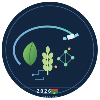
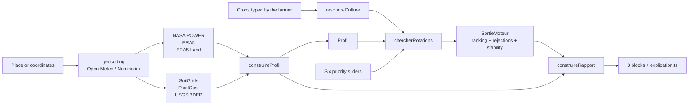

🇫🇷 Version française : [README.fr.md](./README.fr.md)



# Sillon

Sillon turns one geographic point into a ranked, auditable crop-rotation decision for a West
African farmer, using live Earth-observation and soil data — no demo dataset, no hard-coded
rotation catalogue.

---

## 1. What it is

You give a place (name, coordinates, or your position) and the crops you actually grow. Sillon
queries public Earth-observation and soil services, derives the agronomic properties of that
point, builds every two- and three-crop succession from your own crops, removes the infeasible
ones with a written reason, ranks the rest against the priorities you declared, and writes an
eight-block report in plain French — with the money in FCFA per hectare, always compared to your
current rotation.

Built for the NASA Space Apps Challenge 2026, challenge *Field Shift: Adapting Farms with NASA
Data*. Audience for this document: judges who need to audit the algorithms, check a number, and
run the app locally.

## 2. How the app answers the challenge

The brief names five pillars. This table maps each pillar to the file and function that
implements it. Wording in the first column condenses the brief as given to the team; it is not a
verbatim quotation of the official page.

| Challenge requirement | Where it is handled |
| --- | --- |
| Earth observations: rainfall, temperature, evaporative demand, soil moisture, satellite imagery | `src/api/sources.ts` — `chargerPower` (line 100), `chargerEra5` (183), `chargerHumiditeSol` (231), `tuilesGibs` (612) |
| Soil data: texture, organic carbon, pH, plant-available water | `src/api/sources.ts` — `solIsric` (293), `chargerClassificationSol` (514); aggregation in `src/analyse/features.ts` — `construireProfil` (260) |
| Crop characteristics: seasonal water demand, rooting, nitrogen fixation, residue cover, return interval | `src/data/cultures.ts` — `Culture` (15), `CULTURES` (63), 23 crops |
| Farmer priorities: income, food security, water saving, input autonomy, soil, labour | `src/App.tsx` — `CURSEURS` (49); `src/moteur/moteur.ts` — `calculerPoids` (76) |
| Rotation strategies | `src/moteur/moteur.ts` — `construireEspace` (250), `chercherRotations` (680) |
| Making the result usable and contestable by the farmer | `src/rapport/rapport.ts` (8 blocks), `src/rapport/explication.ts` (3-step plain-language layer) |

## 3. Run it in five steps

```bash
git clone https://github.com/gandxo-tech/sillon.git
cd sillon
npm install
npm run dev          # http://localhost:3000  (vite.config.ts, line 13)
```

Production build and checks:

```bash
npm run build        # tsc --noEmit && vite build
npm test             # engine + explanation test suites
```

Environment variables, both optional:

| Variable | Side | Effect when absent |
| --- | --- | --- |
| `VITE_GOOGLE_MAPS_API_KEY` | browser (`src/components/PointMap.tsx`, line 12) | embedded satellite view without click-to-move |
| `GROK_KEY` (alias: `GROQ_API_KEY`) | server (`api/ia.js`) | `/api/ia` returns HTTP 503 with an explicit message; the rest of the app works |

No key is required to reach a full report.

## 4. Architecture

```
api/
  ia.js                     Vercel function: POST only, forwards a bounded context to Groq
src/
  App.tsx                   UI state machine: place → crops → priorities → report
  api/
    http.ts                 fetchJson with timeout, descriptive errors, small stats helpers
    sources.ts              one function per public service; every endpoint lives here
  analyse/
    features.ts             raw API payloads → Profil (climate, soil, relief, source status)
    rotations.ts            water balance, RUSLE, nitrogen, organic matter, scoring
  data/
    cultures.ts             23 crops: kc, season share, rooting, N demand/fixation, residues
  moteur/
    des.ts                  FNV-1a hash, mulberry32 PRNG, deterministic variant index
    moteur.ts               search space, hard filters, weighted scoring, stability test
    __tests__/              six engine cases + fixtures (scenarios.ts)
  rapport/
    rapport.ts              8 blocks, FCFA/ha, months, comparison table
    explication.ts          6 zone archetypes, 3-step explanations, 6 variants per slot
    variantes.ts            6 phrasings per report slot, deterministic, never reused
    leviers.ts              one concrete action per rejection code, ordered by cases unlocked
    technique.ts            folded block 8 (the only place where jargon is allowed)
    __tests__/              11 explanation cases + control table
  components/               map, charts, verdict badge, culture picker, speech button
```

Data flow:



## 5. Data sources

| Source | Endpoint | Variables requested | Resolution | Licence / attribution | Fallback on failure |
| --- | --- | --- | --- | --- | --- |
| NASA POWER (LaRC) | `power.larc.nasa.gov/api/temporal/daily/point` (community `AG`) | `PRECTOTCORR`, `T2M`, `T2M_MAX`, `T2M_MIN`, `GWETTOP` | 0.5° × 0.625°, daily, 10 years | Free and open, cite NASA POWER | none: the report stops with an explicit error |
| ERA5 (Copernicus/ECMWF, via Open-Meteo Archive) | `archive-api.open-meteo.com/v1/archive` | `precipitation_sum`, `temperature_2m_mean/min/max`, `et0_fao_evapotranspiration` | ERA5 native grid 0.25°; the in-app label says ≈9 km (provider's advertised figure — see limitations) | Copernicus licence, attribution "Generated using Copernicus Climate Change Service information" | FAO-56 reference demand recomputed with Hargreaves on POWER temperatures (`features.ts`, `et0Hargreaves`, line 82) |
| ERA5-Land (via Open-Meteo Archive) | same endpoint, `hourly=soil_moisture_0_to_7cm` | soil moisture 0–7 cm, monthly means | ≈9 km | Copernicus licence | `humiditeSol: null`; charts omit the curve |
| SoilGrids 2.0 (ISRIC) | `rest.isric.org/soilgrids/v2.0/properties/query` | `clay`, `sand`, `silt`, `soc`, `phh2o`, `wv0033`, `wv1500` at 0-5, 5-15, 15-30, 30-60 cm | 250 m | CC BY 4.0, cite ISRIC | PixelGust re-encoding of SoilGrids (`solPixelGust`, line 333), then WRB class priors (`chargerClassificationSol`, line 514), then documented defaults |
| SoilGrids classification | `rest.isric.org/soilgrids/v2.0/classification/query` | WRB class | 250 m | CC BY 4.0 | texture priors table, source marked `wrb` or `defaut` |
| USGS 3DEP (EPQS) | `epqs.nationalmap.gov/v1/json` | elevation at 5 points, 1 km apart | 1 m posting, US only | Public domain (US Government) | Open-Meteo elevation (Copernicus DEM GLO-90) `api.open-meteo.com/v1/elevation` |
| Open-Meteo forecast | `api.open-meteo.com/v1/forecast` | 14-day rain, tmin, tmax, ET0 | 1–11 km | CC BY 4.0 data, free for non-commercial use | section hidden |
| CMIP6 (Open-Meteo Climate API) | `climate-api.open-meteo.com/v1/climate` | daily rain and temperature, one model | ~25 km | CC BY 4.0 | projection card hidden |
| NASA GIBS | `gibs.earthdata.nasa.gov/wmts/epsg3857/best/MODIS_Terra_CorrectedReflectance_TrueColor/...` | true-colour tiles | 250 m, daily | NASA imagery, cite NASA EOSDIS GIBS | base map stays on the embedded satellite view |
| Open-Meteo geocoding | `geocoding-api.open-meteo.com/v1/search` | place names | — | CC BY 4.0 | manual coordinate entry |
| OpenStreetMap / Nominatim | `nominatim.openstreetmap.org/reverse` | reverse geocoding | — | ODbL, attribution "© OpenStreetMap contributors" | place named by coordinates |
| Google Maps JavaScript API | `maps.googleapis.com/maps/api/js` | satellite base map, click to move the point | 1 m imagery | Google Maps Platform terms; key restricted by HTTP referrer | embedded map without interaction |

Every source's status is recorded in `Profil.sources` and printed in block 8, so a failed service
is visible instead of being silently replaced.

```ts
// src/api/sources.ts, lines 69 and 104-110
const PARAMS_POWER = ['PRECTOTCORR', 'T2M', 'T2M_MAX', 'T2M_MIN', 'GWETTOP'];
const url =
  `https://power.larc.nasa.gov/api/temporal/daily/point?parameters=${PARAMS_POWER.join(',')}` +
  `&community=AG&longitude=${lon.toFixed(4)}&latitude=${lat.toFixed(4)}` +
  `&start=${debutAnnee}0101&end=${finAnnee}1231&format=JSON`;
```

## 6. Algorithms

All formulas live in `src/analyse/rotations.ts` (`calculerScenario`, line 95) and
`src/analyse/features.ts`. No formula is duplicated in the engine.

**Water balance.** Demand is the seasonal reference demand weighted by each crop's crop
coefficient and the share of the season it occupies; supply is 85 % of seasonal rainfall plus the
water the soil can hold for those crops, plus declared irrigation.

```
demande = mean(et0Saison × kc × partSaison)            [mm]
reserve = awcMm × mean(facteurReserve)                 [mm]
apport  = 0.85 × pluieSaison + reserve + irrigation    [mm]
deficit = max(0, demande − apport)                     [mm]
stress  = deficit / demande                            [0–1]
perte   = (0.95 − 0.42 × tolerance) × stress^0.85       [fraction of yield]
rendement = clamp(1 − perte, 0.35, 1)                  [fraction]
```

The 0.85 factor stands for the share of rainfall that actually infiltrates; the 0.35 lower bound
is the floor below which the model refuses to extrapolate. Both are assumptions, not measurements.

**Erosion (RUSLE).** Rainfall erosivity is a quadratic fit on annual rainfall, clamped to
150–2400 mm; LS follows the slope-length form with slope in percent (2 % assumed when relief is
unavailable); K comes from a texture table (`features.ts`, `facteurK`, line 227).

```
R  = 587.8 − 1.219 P + 0.004105 P²        [MJ mm ha⁻¹ h⁻¹ yr⁻¹], P clamped to 150–2400 mm
LS = (100/22.13)^0.4 × (0.065 + 4.56 s + 65.41 s²),  s = slope / 100
A  = max(0.1, R × K × LS × C / 10)       [t ha⁻¹ yr⁻¹]
```

**Nitrogen.** `azote = max(0, mean(demande azote) − 0.55 × mean(fixation))` in kg N/ha, priced at
650 FCFA/kg (`PRIX_N_FCFA_KG`, `src/data/cultures.ts`, line 210).

**Organic matter.** `mo10 = 10 × (0.018 × (residus − 3.2) + 0.03 if couverture > 0.9)`, in points
over ten years.

**Sub-scores (0–100).** Water `bornes(100 × efficience^0.8 × (0.86 + 0.14 × tolerance) − 25 ×
stress)`; soil `0.55 × (100 − erosion/9×100) + 0.25 × (50 + mo10×200) + 0.2 × (100 − azote×0.45)`;
income `bornes(100 × revenuNetFcfa / 560 000)`; food security `0.6 × calories + 0.4 ×
autoconsumption share − 25 × rupture`; inputs `100 × (1 − annual input cost / annual net income)`
plus a legume bonus of 8–14 points and an order bonus of 4 points per legume-then-non-legume
transition; labour `100 − 100 × days / 120`.

**Aggregation.** Weights are `1 + k × slider`, k = 3 (income, food security), 2 (water, inputs),
1 (soil, labour), normalised to sum to 1 (`calculerPoids`, `moteur.ts`, line 76). The score is the
weighted sum of sub-scores, bounded to 0–100.

```ts
// src/analyse/rotations.ts, lines 108-116
const demandeEau = moy(cultures.map((c) => et0Saison * c.kc * c.partSaison));
const reserveMobilisable = ctx.awcMm * moy(cultures.map((c) => c.facteurReserve));
const apportEau = pluieSaison * 0.85 + reserveMobilisable + ctx.irrigation;
const deficit = Math.max(0, demandeEau - apportEau);
const stress = demandeEau > 0 ? deficit / demandeEau : 0;
const perte = stress > 0 ? (0.95 - 0.42 * tolerance) * Math.pow(stress, 0.85) : 0;
const rendement = bornes(1 - perte, 0.35, 1);
```

**Hard rejection thresholds.** Stress above 0.55 rejects a succession; erosion above 7 t/ha/yr on
a slope above 8 % rejects it; annualised input cost above the declared budget rejects it (budget:
100 000 / 250 000 / 500 000 FCFA per hectare per year, `CAPITAL_FCFA`, line 98); pH outside the
crop range, a return interval below 60 % of the recommended delay, or a fodder crop with no
declared livestock also reject.

## 7. Decision engine

There is no rotation catalogue. `construireEspace` (`moteur.ts`, line 250) takes the crops the
farmer typed and generates every ordered pair and ordered triple **from those crops alone** (up to
8, deduplicated by crop id), discarding successions whose individual cycles do not fit the season
(+15 days tolerance). The 23-crop reference base is opened only when none of those successions
survives the hard filters; the report then states that the search was widened. A crop the farmer
does not own is never proposed silently.

Why the hard-coded catalogue was removed: an 18-archetype library always returned one of its own
rotations, so a farmer growing dolique or taro was answered with a rotation he does not practise.
With a generated space, the farmer's own crops are the vocabulary, an unknown crop gets generic
coefficients flagged as approximate, and the answer is always expressible with what he owns.

Pipeline, in order (`chercherRotations`, line 680):

1. weights from the six sliders;
2. space generation from the typed crops;
3. evaluation of each succession (water, erosion, nitrogen, organic matter, income, labour);
4. hard filters, each returning a code and a French sentence (`verifier`, line 472);
5. reference candidate = the farmer's current rotation, evaluated but never filtered;
6. ranking by weighted score; ties broken by id so the output is stable;
7. rejection list, one representative per cause so a frequent cause cannot hide a rare one;
8. stability test: the whole ranking is recomputed at −10 % and −20 % rainfall; the result is
   `fragile` when the gap between first and third place falls under 4 points.

Rejection codes: `CYCLE`, `RETOUR`, `PH`, `EROSION`, `MARCHE`, `CAPITAL`, `EAU`.

```ts
// src/moteur/moteur.ts, lines 514-530
const budget = CAPITAL_FCFA[e.capital];
const coutAnnuel = m.coutIntrantFcfaHa / s.cultures.length;
if (coutAnnuel > budget) {
  return {
    code: 'CAPITAL',
    cause: 'budget',
    phrase: `${s.nom} écartée : ${Math.round(coutAnnuel / 1000) * 1000} FCFA d’intrants par hectare et par an, votre budget est de ${Math.round(budget / 1000) * 1000} FCFA.`,
  };
}
if (m.base.stress > 0.55) {
  return { code: 'EAU', cause: 'eau', phrase: `${s.nom} écartée : elle manquerait d’eau à ${Math.round(m.base.stress * 100)} %, au-delà de 55 % on ne tente pas.` };
}
```

## 8. Plain-language layer

`src/rapport/explication.ts` turns a scored verdict into three sentences, always in this order:
the fact about the plot, what it means for the rotation, what it costs the farmer. Six
archetypes are derived from already-loaded data — nothing is typed by the user:

| Archetype | Explicit threshold | Measured from |
| --- | --- | --- |
| `sec` (dry) | annual rain / annual reference demand < 0.50 | POWER rainfall, ERA5 demand |
| `pluies_fortes` (heavy rain) | ≥ 6 mm per season day | seasonal rain / season length |
| `pente` (slope) | ≥ 2 % | USGS 3DEP / Copernicus DEM |
| `terre_lourde` (heavy soil) | clay ≥ 35 % over 0–30 cm | SoilGrids |
| `terre_sableuse` (sandy soil) | sand ≥ 70 % over 0–30 cm | SoilGrids |
| `plaine_basse` (low flat land) | altitude ≤ 350 m and slope < 2 % | DEM |

Writing rules, enforced by the test suite: 20 words per sentence at most, second person plural,
active voice, one number per explanation and always compared to the current rotation, money in
FCFA per hectare, dates as months, no "il faut", no "optimal", no "recommended by the model". A
favourable verdict always ends with a concrete reservation. At most two archetypes are cited — the
two with the largest margin above their threshold; a threshold that is not crossed can never be
cited. When no threshold is crossed the explanation says so instead of inventing a cause.

Each slot has six phrasings; the choice is `hash(parcelle, emplacement) % 6`, and a phrasing
already used in the same report is skipped (`tirer`, line 361).

```ts
// src/rapport/explication.ts, lines 80-88
sec: {
  seuil: 'pluie annuelle divisée par la soif de l’air < 0,50',
  marge: (m) =>
    m.soifAirAnnuelleMm > 0 && m.pluieAnnuelleMm / m.soifAirAnnuelleMm < 0.5
      ? (0.5 - m.pluieAnnuelleMm / m.soifAirAnnuelleMm) / 0.5
      : 0,
},
```

Every explanation carries `{ texte, archetypes, faits, source }`: the archetypes cited, the
measured value with its threshold, and the name of the computation. The trace is printed inside
block 8, which is folded by default — so a judge can go from the sentence to the number in one
click without a single technical word appearing in blocks 1 to 7.

## 9. Report structure

Eight blocks, in this order (`construireRapport`, `src/rapport/rapport.ts`, line 120):

1. **The answer** — yes / yes under conditions / no, in one sentence, plus the rotation name.
2. **Why** — the plain-language explanation, then up to three reasons tied to the criteria won.
3. **What it changes for you** — comparison table: your rotation plus the three options, rows for
   labour, money (FCFA/ha) and water (mm missing).
4. **The three options, ranked** — score out of 100, what each wins, what each costs.
5. **If the season goes wrong** — what changes with 20 % less rain, which option holds, when to sow.
6. **What the tool cannot know** — five permanent blind spots (compaction, pests, sowing quality,
   contracts, 250 m soil pixels).
7. **To check in the field** — four physical checks before spending money.
8. **Sources and failures** — folded: candidate count, applied weights, water balance and RUSLE
   description, stability results, rejection codes, per-source status, explanation trace.

Between blocks 4 and 5 sits an unnumbered block, **what the engine set aside**: the five nearest
rejected rotations, and under them up to three levers from `src/rapport/leviers.ts`. Each rejection
code (`EAU`, `CAPITAL`, `MARCHE`, `RETOUR`, `PH`, `EROSION`, `CYCLE`) maps to one concrete gesture,
ordered by how many rejections it would unlock, so a rejection is an action and not a dead end.
When nothing passes at all, the first lever is repeated in block 1: the answer is never a bare no.

Money is rounded to 5 000 FCFA, dates are month names, and every figure is either a value
computed by `calculerScenario` or a source status.

## 10. Known limitations

- **Soil at 250 m.** SoilGrids is a global prediction grid, not a measurement of your field. One
  soil sample can contradict a whole report; the app says so in block 6.
- **One CMIP6 model.** The projection card shows a single model, so it carries model uncertainty,
  not a probability distribution.
- **Compaction is invisible.** Nothing in the data sees a plough pan; a compacted field can score
  well and yield badly.
- **Pests and diseases are invisible.** Return intervals are the only proxy, and they are
  agronomic rules of thumb, not observations.
- **No campaign prices.** Crop margins come from a fixed table in `src/data/cultures.ts`, not from
  the market of the week. A price crash invalidates the income ranking.
- **RUSLE K is tabulated.** `facteurK` maps a texture class to a K value; it is not fitted to the
  local soil.
- **Seven public APIs, browser-side CORS.** Any of them can rate-limit, change a field or fail
  CORS. The app degrades and reports the failure, but the report is weaker.
- **Google Maps key is client-side.** `VITE_GOOGLE_MAPS_API_KEY` is visible in the bundle; it must
  be restricted by HTTP referrer and quota.
- **ERA5 resolution label.** The in-app status says ≈9 km, the provider's advertised figure; the
  native ERA5 grid is 0.25° (≈25–30 km at these latitudes), so the label overstates precision.
- **Input costs, not profits.** The budget filter compares input cost to a declared budget; it
  does not model credit, family labour valuation, or land tenure.
- **No field validation.** The model output has not been compared to measured yields on real
  plots; that is the next step, not a claim.
- **The AI advice is unverified.** It is a language model, not an agronomist: it can be fluent and
  wrong. It sees only the context sentence the app builds (verdict, scores, money, water, work,
  sowing months, and what blocks), not the field. The per-address cap lives in instance memory, so
  it is a brake on a single visitor, not a quota guarantee across concurrent instances.

## 11. Tests

```bash
npm test          # tsc -p tsconfig.test.json, then three suites in Node
npm run tableau   # prints which rotation wins across the five reference scenarios
```

`npm test` runs 24 cases:

- `src/moteur/__tests__/moteur.test.ts` — 8 cases: a dry plot with income priority keeps no
  cover-only rotation; without livestock no lucerne is ranked and the reason is written; a maize
  history pushes maize out of the first two years; opposite priorities on the same plot give
  different rankings; the same input twice gives byte-identical output; an unknown crop is
  accepted and actually searched; proposals stay inside the declared crops when those suffice; when
  none of them passes, the reference base is opened and the output says the search was widened.
- `src/rapport/__tests__/explication.test.ts` — 11 cases: one per archetype (detected, cited, text
  conforms), the neutral case, two-archetype truncation, determinism, no repetition within one
  report, plus the printed control table archetype → cited archetype.
- `src/rapport/__tests__/leviers.test.ts` — 5 cases: every rejection yields an action, at most
  three levers ordered by the number of rejections they unlock, determinism, the summary handed to
  the AI, and no engine jargon inside the actions.

Not covered: real network calls (all API payloads are mocked through fixtures), browser rendering,
the Vercel function, CORS behaviour, and agronomic validity of the coefficients.

## 12. Reproducibility

- Seed: `graineDepuis(lat, lon, cropIds)` → FNV-1a 32-bit over `"lat|lon|ids"` (`src/moteur/des.ts`,
  line 20); the variant generator is mulberry32 (`line 28`). Two runs on the same point and the
  same crops produce identical scores, identical sentences.
- No `Math.random()` in the engine or the report.
- Node: `>= 20` (developed on 26.13.0). Vercel builds with `nodeVersion 26.x`.
- Dependencies are pinned by `package-lock.json`; the project adds no runtime dependency beyond
  React and React DOM, and the test suites run on `tsc` alone.
- Reference fixtures: `src/moteur/__tests__/scenarios.ts` holds the five input scenarios; running
  `npm test` and `npm run tableau` on a fresh clone must print the same winners.

## 13. Privacy and keys

- Every agronomic call goes from the browser to the public API directly. No request passes through
  a Sillon server, and nothing is stored: no cookie, no local storage of the plot, no analytics.
- The only server-side route is `POST /api/ia` (`api/ia.js`). It receives `contexte` (truncated to
  4 000 characters) and `question` (truncated to 500), and forwards them to Groq with the
  server-side key read from `GROK_KEY`, falling back to `GROQ_API_KEY`. The model is not hard-coded:
  the route asks `/v1/models` with that key, takes the first entry of a preference list that is
  actually available, and caches the choice for ten minutes. Each call has a 20-second ceiling, a
  per-address cap of six calls per five minutes per instance (HTTP 429 beyond), a
  `Cache-Control: no-store` response, and a system prompt that treats the client context as data,
  never as instructions. The key is never sent to the browser. Queries to Groq are subject to
  Groq's terms.
- `VITE_GOOGLE_MAPS_API_KEY` is public by construction. Restrict it to your own HTTP referrers and
  to the Maps JavaScript API only, with a spending quota.
- The report is generated locally; the PDF/share features use what is already on screen.

## 14. Roadmap to a cooperative deployment

1. Calibrate water and yield coefficients on measured plots (at least one season, three sites).
2. Replace the fixed margin table with a market-price feed per crop and per country.
3. Add a soil-sample import so texture and pH can override SoilGrids.
4. Batch mode: one report per member of a cooperative, aggregated for the adviser.
5. Offline-first: cache the last profile and the report, because rural connectivity is intermittent.
6. Multi-model climate projection with an explicit spread instead of a single CMIP6 run.
7. Local-language audio (the speech button exists; the phrasing layer needs translation).

## 15. Team and credits

Soil AI Crew — a three-person team. Member names and contact details are the contributors listed
on this repository's GitHub page; roles were: agronomy and field constraints, data and algorithms,
interface and plain-language writing.

Team logo: `public/logo-soil-ai-crew.svg`, used as the header mark and the favicon.

Submission dossier: `SOUMISSION.md` (English) and `SOUMISSION.fr.md` (French). Oral script and prepared answers: `ORAL.md`. Audit: `AUDIT.md`.

Data credits: NASA POWER (NASA Langley Research Center), NASA GIBS/EOSDIS for MODIS imagery,
Copernicus Climate Change Service (ERA5, ERA5-Land), ISRIC SoilGrids, USGS 3DEP, Open-Meteo,
OpenStreetMap contributors, Google Maps Platform.

## 16. Licence

Source code in this repository: MIT.

```
Copyright (c) 2026 Soil AI Crew

Permission is hereby granted, free of charge, to any person obtaining a copy of this software and
associated documentation files (the "Software"), to deal in the Software without restriction,
including without limitation the rights to use, copy, modify, merge, publish, distribute,
sublicense, and/or sell copies of the Software, and to permit persons to whom the Software is
furnished to do so, subject to the following conditions:

The above copyright notice and this permission notice shall be included in all copies or
substantial portions of the Software.

THE SOFTWARE IS PROVIDED "AS IS", WITHOUT WARRANTY OF ANY KIND, EXPRESS OR IMPLIED, INCLUDING BUT
NOT LIMITED TO THE WARRANTIES OF MERCHANTABILITY, FITNESS FOR A PARTICULAR PURPOSE AND
NONINFRINGEMENT. IN NO EVENT SHALL THE AUTHORS OR COPYRIGHT HOLDERS BE LIABLE FOR ANY CLAIM,
DAMAGES OR OTHER LIABILITY, WHETHER IN AN ACTION OF CONTRACT, TORT OR OTHERWISE, ARISING FROM,
OUT OF OR IN CONNECTION WITH THE SOFTWARE OR THE USE OR OTHER DEALINGS IN THE SOFTWARE.
```

Third-party data is **not** covered by this licence and keeps its own terms: SoilGrids is CC BY
4.0 (ISRIC), ERA5/ERA5-Land are under the Copernicus licence with attribution, USGS 3DEP is public
domain, NASA POWER and GIBS require attribution to NASA, Open-Meteo data is CC BY 4.0 with a free
tier limited to non-commercial use, OpenStreetMap data is ODbL, and Google Maps imagery follows the
Google Maps Platform terms. The crop coefficients and margin table in `src/data/cultures.ts` are
project assumptions, marked `source: 'estime'`, not published measurements.
